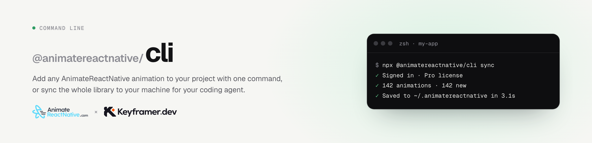

<picture>
  <source media="(prefers-color-scheme: dark)" srcset="https://raw.githubusercontent.com/animate-react-native/cli/main/docs/banner-dark.png">
  
</picture>

# @animatereactnative/cli

The command line for [AnimateReactNative.com](https://www.animatereactnative.com), a library of React Native animations built by hand with Reanimated, Gesture Handler, Moti and Skia.

It puts an animation's real source into your project as plain files, or keeps a copy of the whole library on your machine for your coding agent to read.

```sh
npx @animatereactnative/cli login
npx @animatereactnative/cli add <slug>
```

Nothing to install. It needs Node 18 or newer.

## Commands

| Command | What it does |
| --- | --- |
| `login` | Signs this machine in. It opens the site in your browser; you confirm there. |
| `add <slug>` | Writes one animation's source files into your project. |
| `list` | Lists every animation with its slug. `--search <text>` filters, `--refresh` skips the local cache. |
| `sync` | Copies the whole library to this machine, or pulls what changed since last time. |
| `preview <slug>` | Prints a code to scan with the free preview app, to try the animation on your phone. |
| `config` | Sets the folder `add` saves into. |

## Add one animation

```sh
npx @animatereactnative/cli add shimmer-text
```

It asks where to save (`src/components` by default) and writes the files to `<that folder>/<slug>/`. They are plain source files: no package to depend on, every line open to change.

The slug is the last part of an animation's address on the site, and `list` prints them all. Each animation's page lists the packages it needs, with the install command.

## Sync the whole library

```sh
npx @animatereactnative/cli sync
```

```
~/.animatereactnative/
├─ registry.json          every animation, its tags and packages
├─ animations/<slug>/     the source files, meta.json and PROMPT.md
└─ skill/                 the patterns behind the library, for your agent
```

Run it again and it downloads only what was added or changed. Point your coding agent at the folder: it can search `registry.json` offline and read the source from disk.

| Option | What it does |
| --- | --- |
| `--dir <path>` | Keep the copy somewhere else. |
| `--force` | Download every animation again. |

## What you need

- **An account.** `login` signs you in with GitHub on the site.
- **A license for the paid animations.** `add` and `list` need one. `sync` works with any account: without a license it downloads the free animations and lists the rest as locked. One license covers every animation, in as many projects as you like: [pricing](https://www.animatereactnative.com/pricing).

Your sign-in is kept in `~/.animatereactnative/auth.json`. Delete that file to sign this machine out.

## Other ways in

- **MCP server.** Your agent searches the library and reads the source itself: `claude mcp add --transport http animatereactnative https://www.animatereactnative.com/mcp`
- **Skill.** A free skill that teaches your agent how the animations are built: `npx skills add animate-react-native/skill`

## Working on the CLI

```sh
bun install
bun run dev                     # rebuilds on change
node dist/index.js --help
APP_URL=http://localhost:3000 node dist/index.js login   # against a local copy of the site
```

## License

MIT
